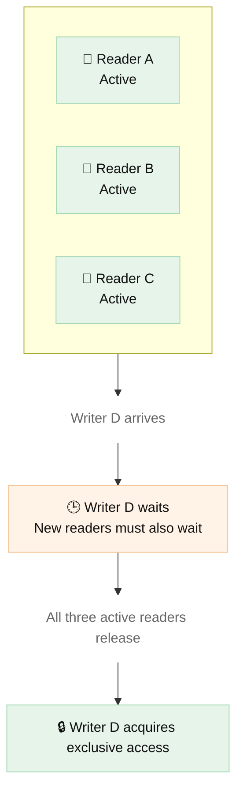

## Designing the Reader-Writer Inode Lock.
Our implementation plan:  

- Create a new reader-writer lock structure.
- Implement lock initialization.
- Implement shared reader acquisition and release.
- Implement exclusive writer acquisition and release.
- Add a policy to prevent writer starvation.
- Integrate the new lock into xv6's inode operations.
- Compile, boot, and test the modified kernel.

**Step 1 — Design the lock structure**  
Proposed Structure: 
```powershell
struct rwlock {
  struct spinlock lk;
  int readers;
  int writer;
  int waiting_writers;
  char *name;
};
```
Each variable has a specific purpose  


| Field | Initial value | Purpose |
|-------|---------------|---------|
| `lk` | Initialized using `initlock()` | Protects internal lock state |
| `readers` | `0` | Number of active readers |
| `writer` | `0` | Whether a writer currently holds the lock |
| `waiting_writers` | `0` | Number of waiting writers |
| `name` | Supplied name | Identifies the lock |


For example, if three processes are reading the same inode:  
```powershell
readers = 3
writer = 0
waiting_writers = 0
```
If a writer arrives, it must wait until the three readers finish. With a writer-preference policy, new readers will also wait once a writer is queued.  


**Example: Three readers and one writer**



**One important design consideration:** Because xv6 version uses `sleep_prepare()`, `sleep()`, and `wakeup()`, we must design the waiting protocol carefully to avoid lost wakeups. We should also use separate waiting conditions for readers and writers.  

file structure: 
```powershell
xv6/
└── kernel/
    ├── rwlock.h    ← Reader-writer lock structure
    └── rwlock.c    ← Reader-writer lock functions
```
**Implementing `acquireread()`**  
This function will allow multiple processes to acquire the same inode lock for reading, provided no writer is active or waiting.  
This function exists `xv6/kernel/rwlock.c` and below `initrwlock()`:
```powershell
void
acquireread(struct rwlock *lock)
{
  acquire(&lock->lk);

  while (lock->writer || lock->waiting_writers > 0) {
    sleep_prepare(lock);
    release(&lock->lk);
    sleep();
    acquire(&lock->lk);
  }

  lock->readers++;

  release(&lock->lk);
}
```

**Implementing `releaseread()`**  
When a process finishes reading, it must decrement the number of active readers.  
Function location below `acquireread()` in `rwlock.c`:

```powershell
void
releaseread(struct rwlock *lock)
{
  acquire(&lock->lk);

  if (lock->readers < 1)
    panic("releaseread");

  lock->readers--;

  if (lock->readers == 0)
    wakeup(lock);

  release(&lock->lk);
}
```

### Understanding each statement

| Statement | Explanation |
|-----------|-------------|
| `acquire(&lock->lk)` | Protects the internal lock state |
| `lock->readers < 1` | Checks for an invalid release when no readers are active |
| `panic("releaseread")` | Stops the kernel if the lock state is invalid |
| `lock->readers--` | Decreases the number of active readers |
| `lock->readers == 0` | Checks whether the last reader has finished |
| `wakeup(lock)` | Notifies processes sleeping on this lock's channel |
| `release(&lock->lk)` | Releases the internal spinlock |

### Example: Three readers

**Reader release sequence**

> **Reader A releases**  
> Other readers are still active  
> `readers = 2` 📖
>
> ---
>
> **Reader B releases**  
> Other readers are still active  
> `readers = 1` 📖
>
> ---
>
> **Reader C releases**  
> Last reader — notify waiting processes  
> `readers = 0` 🔔

Why do we wake waiting processes only when `readers == 0`?

Because an exclusive writer cannot acquire the lock while even one reader remains active.  

**An important detail about wakeup(lock)**  
In xv6, `wakeup()` clears the sleep channel and makes matching sleeping processes runnable.  
It does not directly grant the lock to a waiting process.  
Every awakened process must reacquire the internal spinlock and check its acquisition condition again.  
Also, our current design uses one sleep channel for both readers and writers. That can cause unnecessary wakeups, and the full writer-preference policy still needs careful validation for starvation and progress.  
We'll review those interactions once both acquisition and release paths exist.  

**Implementing `acquirewrite()`**  
Function Position: below `releaseread()` in `xv6/kernel/rwlock.c`:
```powershell
void
acquirewrite(struct rwlock *lock)
{
  acquire(&lock->lk);

  lock->waiting_writers++;

  while (lock->writer || lock->readers > 0) {
    sleep_prepare(lock);
    release(&lock->lk);
    sleep();
    acquire(&lock->lk);
  }

  lock->waiting_writers--;
  lock->writer = 1;

  release(&lock->lk);
}
```

**Implementing `releasewrite()`**  
Function Position: below `acquirewrite()` in `xv6/kernel/rwlock.c`:
```powershell
void
releasewrite(struct rwlock *lock)
{
  acquire(&lock->lk);

  if (lock->writer == 0)
    panic("releasewrite");

  lock->writer = 0;

  wakeup(lock);

  release(&lock->lk);
}
```

The function performs three main actions:

1. Acquires the internal spinlock to protect the lock's state.
2. Sets `writer = 0`, indicating that exclusive access has ended.
3. Calls `wakeup(lock)` to notify waiting processes.

Notice that `wakeup(lock)` does not automatically grant the lock. It only allows sleeping processes to attempt acquisition again.  


**A subtle problem in our current design**  
Consider the following situation:  

- Reader A is currently reading.
- Writer B arrives and begins waiting.
- Reader C arrives and must wait because Writer B is queued.

**Potential reader starvation due to a missed notification**
1. **Reader A holds the lock**
   > `readers = 1, waiting_writers = 0`

2. **Writer B arrives**
   > `waiting_writers = 1`. Writer B sleeps because Reader A is active.

3. **Reader C arrives**
   > Reader C sleeps because `waiting_writers > 0`.

4. **Reader A releases**
   > `readers = 0`. The release function wakes both waiting processes.

5. **Reader C runs first**
   > It still sees `waiting_writers = 1`, so it goes back to sleep.

6. **Writer B acquires the lock**
   > It changes `waiting_writers` from `1` to `0` and sets `writer = 1`.  

In this particular sequence, Writer B will eventually call `releasewrite()` and wake Reader C, so there is no permanent deadlock.  
But the example demonstrates why we need to reason about every state transition, rather than simply assuming that calling `wakeup()` is always sufficient.  
A more serious concern is fairness between waiting writers: our current implementation has no FIFO ordering, so one waiting writer could repeatedly lose the race to newly arriving writers. Writer preference alone does not prove that every individual writer will eventually acquire the lock.


