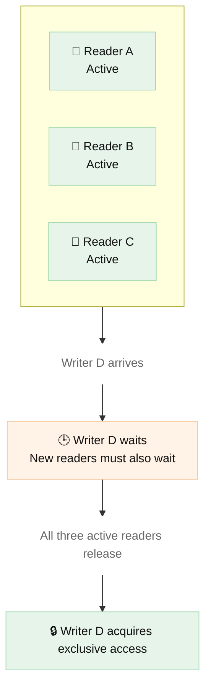

## Designing the Reader-Writer Inode Lock.
Our implementation plan:  

- Create a new reader-writer lock structure.
- Implement lock initialization.
- Implement shared reader acquisition and release.
- Implement exclusive writer acquisition and release.
- Add a policy to prevent writer starvation.
- Integrate the new lock into xv6's inode operations.
- Compile, boot, and test the modified kernel.

**Step 1 — Design the lock structure**  
Proposed Structure: 
```powershell
struct rwlock {
  struct spinlock lk;
  int readers;
  int writer;
  int waiting_writers;
  char *name;
};
```
Each variable has a specific purpose  


| Field | Initial value | Purpose |
|-------|---------------|---------|
| `lk` | Initialized using `initlock()` | Protects internal lock state |
| `readers` | `0` | Number of active readers |
| `writer` | `0` | Whether a writer currently holds the lock |
| `waiting_writers` | `0` | Number of waiting writers |
| `name` | Supplied name | Identifies the lock |


For example, if three processes are reading the same inode:  
```powershell
readers = 3
writer = 0
waiting_writers = 0
```
If a writer arrives, it must wait until the three readers finish. With a writer-preference policy, new readers will also wait once a writer is queued.  


**Example: Three readers and one writer**



**One important design consideration:** Because xv6 version uses `sleep_prepare()`, `sleep()`, and `wakeup()`, we must design the waiting protocol carefully to avoid lost wakeups. We should also use separate waiting conditions for readers and writers.


